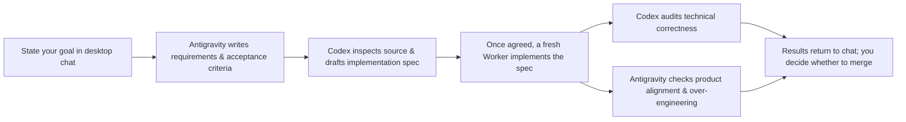
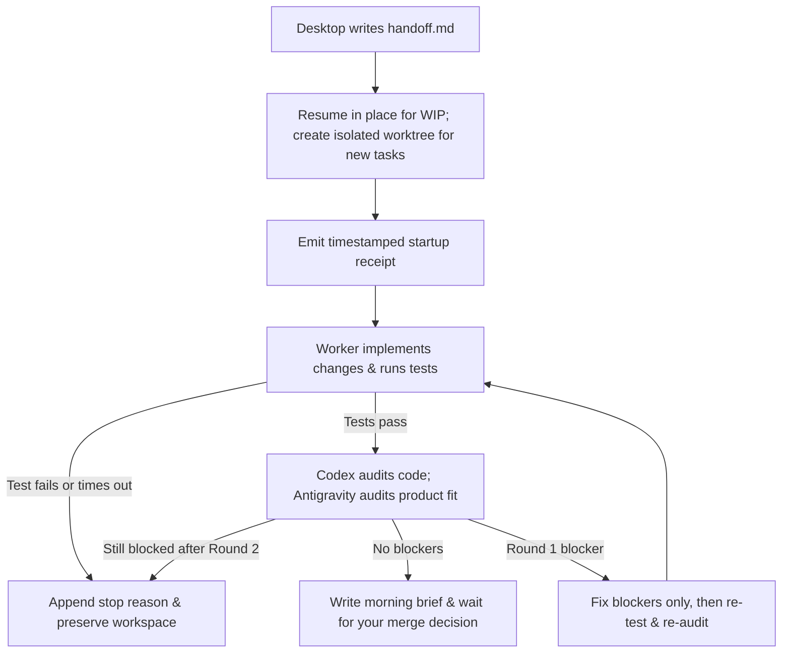
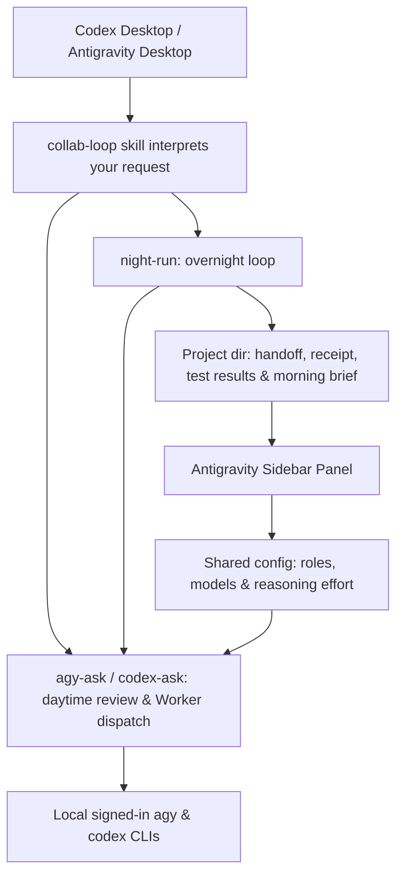

# Desktop Collab Loop

English | [简体中文](README.md)

Clarify product requirements with Gemini in Antigravity during the day, and have Codex inspect your codebase and handle implementation. Before bed, simply say **"I'm going to sleep—finish the remaining tasks in night mode"**: both models will pick up the handoff, run tests, review each other's work, and leave a plain-language morning brief waiting for you. Built for Mac users who already use both tools and want to stop copy-pasting between chat windows.

## Getting Started

**Prerequisites.** You need a Mac, Git, Python 3, and working installations of both [Codex CLI](https://developers.openai.com/codex/cli/) and [Antigravity CLI](https://antigravity.google/docs/getting-started?tab=cli). Run `codex --version` and `agy --version` in your terminal to verify installation, then sign in to each account. Night runs require a Git repository with at least one commit.

**Installation.** Download the [latest release](https://github.com/akechi0819-lgtm/desktop-collab-loop/releases/latest), unzip it, and open a terminal in that folder. To also install the Antigravity sidebar panel for model selection and quota monitoring (requires Node.js 20+ and npm), run:

```sh
./install.sh --with-panel
```

If you only need chat-based collaboration without the sidebar panel, run `./install.sh`. Scripts and configs are installed under your user home directory, and existing files are preserved. If a desktop app cannot find the commands, add `~/.local/bin` to your `PATH` and restart the app, or let the assistant invoke them by absolute path.

**Try a quick prompt.** Open a project in **Codex Desktop** and say: *"Use collab-loop to ask Antigravity to review a line of copy. My goal is to let parents know the registration deadline; the current copy is 'Registration closes Friday at 8 PM.' Tell me in one sentence what's missing."* Gemini's feedback will appear right inside the same chat.

**Switch models.** Open **Model Collab Panel** (`模型协同面板`) from the Antigravity sidebar, pick your preferred models and reasoning efforts for each role, and click Save. The next collaboration call immediately uses the new settings. (Each desktop chat window's own model is still chosen in that window's selector.) You can also edit `~/.local/share/ai-collab/config.json` directly; if you are migrating from an earlier pre-release config, add `cli_paths` following [config.example.json](share/config.example.json).

## Daytime Workflow

Suppose you want to add a required field to a registration page. Talk through who needs to fill it out and how validation errors should read in Antigravity, then say **"Ask Codex to check what this touches, finalize the spec, and spin up an independent Worker to implement it."** For small changes, a single handoff note is enough; for multi-module work, store the requirements and implementation plan in `.local/collab/prd.md` and `.local/collab/spec.md`.



## Overnight Handoff

In the desktop chat where you worked during the day, say **"Switch to night mode—finish only the remaining tasks we agreed on, run the existing tests, and leave it for me to review tomorrow morning."** The desktop assistant writes the remaining checklist and test command into the handoff file. Once it verifies the **startup receipt** and replies that the handoff is active, keep your Mac lid open and lock the screen with Control + Command + Q.



The next morning, say **"Show me last night's morning brief and anything that needs my decision."** The original repository's `.local/collab/latest-run.json` points to the exact working directory, log file, and `handoff.md`. Half-finished daytime work resumes in place; brand-new overnight tasks keep their output in a dedicated Git worktree. Open-lid screen-locked execution has been verified on macOS; clamshell (lid-closed) sleep is outside that verification scope.

## How the Pieces Connect



The sidebar panel also displays live quota cards. Antigravity's weekly and 5-hour remaining percentages (plus reset times) come from the official `agy /usage` command; Codex displays the latest local rate-limit snapshot. Both include snapshot timestamps, open instantly from local cache, and refresh concurrently on demand.

## Scope & Boundaries

- All runs use your existing accounts and model quotas. During reviews, relevant requirements, diffs, or file contents are sent to the corresponding model—choose materials according to your project's data-sharing policy.
- Overnight runs execute the shell test command specified in `handoff.md`. For your first run, start with a familiar small repository that already has tests. If a test fails, check the stop reason appended to the end of `handoff.md`.
- Daytime reviews invoke the target role with a clean context using project files to pass state—both desktop apps do not need to be active simultaneously. Collaboration records stay local to your project.

## License

[MIT](LICENSE). You must install and sign in to each vendor's CLI separately at runtime.
