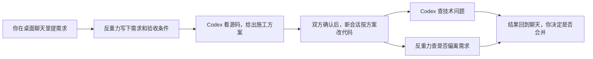
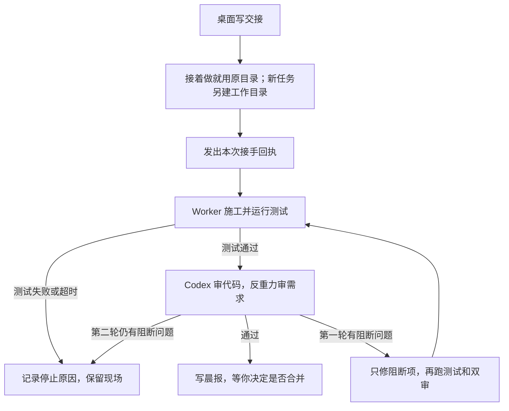
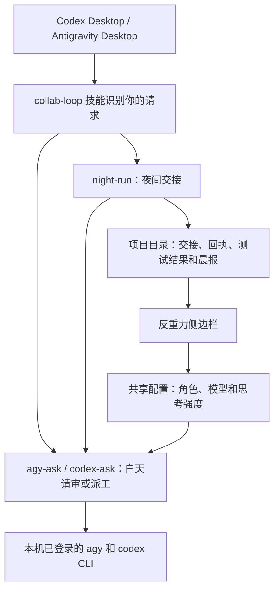

# Desktop Collab Loop · 桌面双模型协作

简体中文 | [English](README.en.md)

白天在 Antigravity（反重力）里用 Gemini 聊清需求，让 Codex 帮你看代码。晚上说一句 **“我要睡了，用夜间模式把剩下的跑完”**，两个模型会接着施工、跑测试、互相审查，把结果写成一份晨报。适合已经在 Mac 上使用这两款工具、想少在聊天窗口之间搬文字的人。

## 第一次使用

**准备。** 你需要一台 Mac、Git、Python 3，以及能分别对话的 [Codex CLI](https://developers.openai.com/codex/cli/) 和 [Antigravity CLI](https://antigravity.google/docs/getting-started?tab=cli)。可以先在终端运行 `codex --version` 和 `agy --version` 检查安装，再分别登录自己的账号。夜间任务需要一个至少有一次提交的 Git 项目。

**安装。** 下载 [最新发布包](https://github.com/akechi0819-lgtm/desktop-collab-loop/releases/latest)，解压后在该目录打开终端。想同时装上能选模型、看额度的侧边栏，请准备 Node.js 20+ 和 npm，然后运行：

```sh
./install.sh --with-panel
```

只需要聊天协作时，运行 `./install.sh` 即可。脚本和配置会装到当前用户目录，已有文件会保留。若桌面应用找不到协作命令，将 `~/.local/bin` 加入 PATH 后重新打开应用，或让助手通过该绝对路径调用。

**试一句。** 在 **Codex Desktop** 打开项目，发：“用 collab-loop 请反重力审一句文案。我的要求是让家长知道报名截止日期，现有文案是‘周五晚上八点截止报名’。请用一句话说清楚还缺什么。” 你应该能在同一个聊天里看到 Gemini 的建议。

**换模型。** 在反重力左侧打开「模型协同面板」，选择账号可用的模型和思考强度，点击保存。下一次协作就会采用这些设置。桌面聊天框自身的模型仍在各自的窗口里选。也可以直接编辑 `~/.local/share/ai-collab/config.json`；如果沿用本项目开源前的旧配置，请对照 [示例配置](share/config.example.json) 补齐 `cli_paths`。

## 白天怎么用

比如你想给报名页加一个必填项。在反重力里聊清楚哪些人需要填、漏填时怎么提示，然后说 **“请 Codex 看看会影响哪些地方，定稿后开一个独立会话做施工。”** 如果是小改动，一份交接说明就够；涉及多个模块时，再把需求和施工方案分别写进项目的 `.local/collab/prd.md` 和 `.local/collab/spec.md`。



## 睡前怎么交出去

在白天工作的那个项目聊天里说 **“用夜间模式接着做，只完成刚才定好的任务，跑现有测试，明早我验收。”** 桌面助手会把剩余任务和测试命令写进交接文件。等它核对**本次启动回执**、回复“已接手”后，就可以保持 Mac 开盖，按 Control + Command + Q 锁屏。



第二天说 **“给我看昨晚的晨报，还有什么需要我决定？”** 原项目的 `.local/collab/latest-run.json` 指向本次实际工作目录、日志和 `handoff.md`。日间项目已有半成品时可原地续跑，全新任务的成果保留在独立工作目录（Git worktree）。开盖锁屏已在 macOS 真机验证；合盖休眠不在该次验证范围内。

## 它们是怎么连起来的



侧边栏还能看额度。Antigravity 的每周和 5 小时剩余比例取自官方 `agy /usage`；Codex 显示本机最近一次限额快照。两者都有采样时间。

## 使用边界

- 工具使用你已有的账号和模型额度。请审时，相关需求、代码差异或文件正文会交给对应模型，按项目的数据共享要求选择材料。
- 夜间任务会执行交接文件里写明的 shell 测试命令。首次使用建议选一个你熟悉的小项目和已有测试。测试失败后可以直接查看交接文件末尾的原因。
- 日间请审会开启对应角色的调用。项目文件负责传递上下文，无需两个桌面窗口同时在线。项目里的协作记录保存在本机。

## 许可证

[MIT](LICENSE)。运行时需要自行安装并登录对应厂商的工具。
